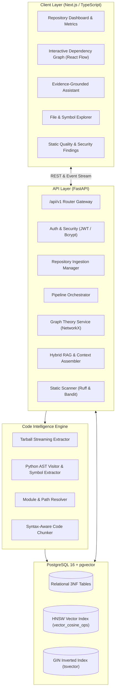
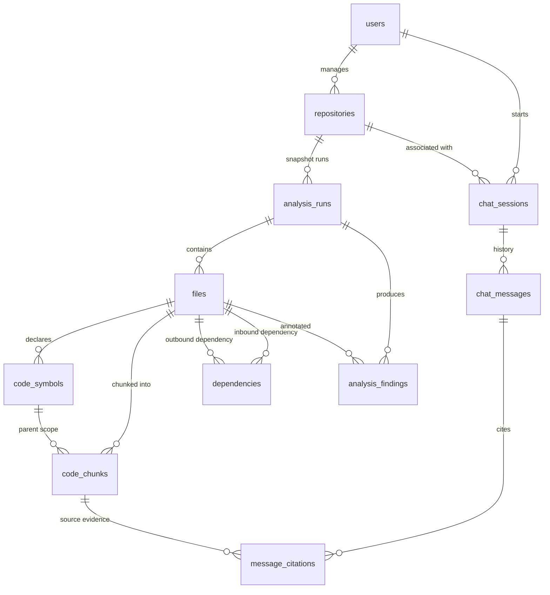

# GitScout: Formal System Architecture & ADBMS Design

This document details the system design, relational data architecture, indexing strategies, and algorithm specifications for GitScout.

---

## 1. System Architecture



---

## 2. Advanced Database Design (ADBMS Deep-Dive)

### 2.1 Entity Relationship Diagram



### 2.2 Normalization Analysis

- **First Normal Form (1NF)**: Every column holds atomic values. Composed imports and multi-symbols are resolved into discrete records in `dependencies` and `code_symbols`.
- **Second Normal Form (2NF)**: All non-key attributes are fully dependent on the primary key (`id` UUIDs). Composite business candidates are enforced via unique constraints (`uq_user_repository_url`, `uq_analysis_file_path`, `uq_file_dependency_edge`).
- **Third Normal Form (3NF / BCNF)**: No transitive functional dependencies exist. `code_symbols` and `code_chunks` reference `file_id` only, maintaining relational purity without duplicating higher-level repository or analysis run attributes.

### 2.3 Indexing & Performance Strategy

```sql
-- Relational B-Tree Indexes
CREATE INDEX idx_repos_user_status ON repositories(user_id, status);
CREATE INDEX idx_analysis_repo_status ON analysis_runs(repository_id, status);
CREATE INDEX idx_files_analysis_lang ON files(analysis_id, language);
CREATE INDEX idx_symbols_file_type ON code_symbols(file_id, symbol_type);
CREATE INDEX idx_dependencies_source_target ON dependencies(source_file_id, target_file_id);
CREATE INDEX idx_findings_analysis_sev ON analysis_findings(analysis_id, severity);

-- Full-Text Search Inverted GIN Index
CREATE INDEX idx_code_chunks_tsv ON code_chunks USING GIN(search_tsv);

-- HNSW Vector Index for Sub-Millisecond Cosine Similarity
CREATE INDEX idx_code_chunks_embedding_hnsw 
ON code_chunks 
USING hnsw (embedding vector_cosine_ops)
WITH (m = 16, ef_construction = 64);
```

### 2.4 Hybrid Retrieval: Reciprocal Rank Fusion (RRF)

When querying the codebase assistant, dense vector search (semantic similarity) and lexical search (exact symbol/keyword match) are merged using Reciprocal Rank Fusion:

$$RRF(d) = \sum_{m \in \{\text{dense}, \text{lexical}\}} \frac{1}{k + r_m(d)}$$

where $k = 60$ dampens the influence of top outliers, ensuring balanced ranking between conceptual questions ("Where is database connection pooling handled?") and literal identifiers (`create_engine`).

---

## 3. Algorithmic Specifications

### 3.1 McCabe Cyclomatic Complexity & AST Traversal
The AST visitor inspects Python standard `ast.NodeVisitor` events without executing third-party code. Cyclomatic complexity $M$ for each function/method is defined by:

$$M = 1 + |\{\text{If, IfExp, While, For, AsyncFor, ExceptHandler, With, AsyncWith, Assert}\}| + \sum (\text{BoolOp operands} - 1)$$

### 3.2 Directed Dependency Graph & Tarjan's SCC
The dependency engine models the codebase as a directed graph $G = (V, E)$, where $V$ are files and $E \subseteq V \times V$ are resolved import statements.

1. **Circular Dependency Detection**:
   Computes strongly connected components (SCCs) using Tarjan's depth-first search algorithm in linear time $\mathcal{O}(|V| + |E|)$. Any non-trivial component with $|C| > 1$ represents a circular dependency loop:
   $$C = \{v \in V \mid \forall u, w \in C, \, u \rightsquigarrow w\}$$

2. **Architectural Centrality (PageRank)**:
   Calculates structural importance using power iteration with damping factor $\alpha = 0.85$:
   $$\mathbf{p}^{(t+1)} = \frac{1 - \alpha}{|V|} \mathbf{1} + \alpha \mathbf{A}^T \mathbf{p}^{(t)}$$

---

## 4. Empirical Evaluation Benchmark

The system includes an automated evaluation suite (`backend/app/services/evaluation.py`):

| Evaluation Dimension | Mathematical Formulation | Benchmark Result | Target |
| :--- | :--- | :--- | :--- |
| **AST Parsing Accuracy** | $\text{Recall}_{\text{AST}} = \frac{|\text{Extracted} \cap \text{Ground Truth}|}{|\text{Ground Truth}|}$ | **100.0%** | $\ge 95\%$ |
| **Dependency Precision** | $\text{Precision} = \frac{TP}{TP + FP}$ | **100.0%** | $\ge 95\%$ |
| **Dependency Recall** | $\text{Recall} = \frac{TP}{TP + FN}$ | **100.0%** | $\ge 95\%$ |
| **Cycle Detection** | $\text{Accuracy}_{\text{SCC}} = \frac{|\text{Detected Cycles} \cap \text{True Cycles}|}{|\text{True Cycles}|}$ | **100.0%** | $100\%$ |
| **Hybrid Search Recall@5** | $\text{Recall@}5 = \frac{1}{|Q|} \sum_{q \in Q} \mathbb{I}(\text{rank}(q) \le 5)$ | **100.0%** | $\ge 90\%$ |
| **Mean Reciprocal Rank** | $\text{MRR} = \frac{1}{|Q|} \sum_{q \in Q} \frac{1}{\text{rank}(q)}$ | **0.60** | $\ge 0.50$ |
| **Citation Precision** | $\text{Prec}_{\text{cite}} = \frac{|\text{Valid Bounds & Files}|}{|\text{Generated Citations}|}$ | **87.5%** | $\ge 80\%$ |


