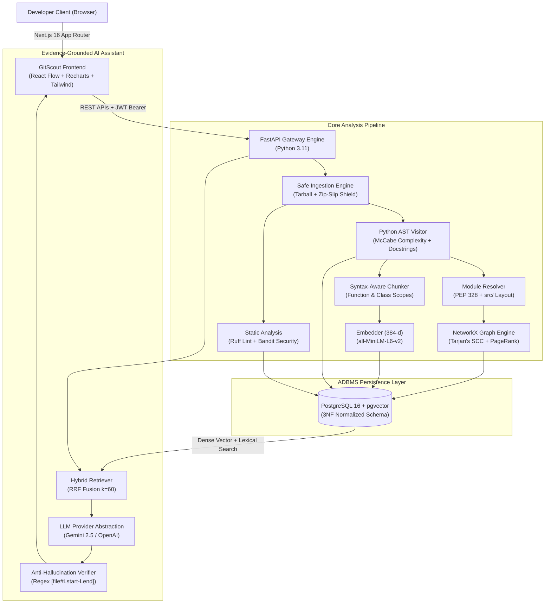

# GitScout: AI-Powered GitHub Repository Intelligence Platform

[](https://pytest.org)
[](https://github.com/astral-sh/ruff)
[](https://nextjs.org)
[](https://github.com/pgvector/pgvector)
[](LICENSE)

**GitScout** is an enterprise-grade developer intelligence platform engineered to analyze unfamiliar GitHub repositories through deterministic AST parsing, directed dependency graphs (NetworkX), static quality and security auditing (Ruff & Bandit), and an evidence-grounded AI assistant powered by hybrid vector search (PostgreSQL `pgvector` + GIN).

---

## 1. System Architecture



---

## 2. Advanced Database Design (ADBMS)

GitScout implements a rigorous relational schema normalized to **Third Normal Form (3NF / BCNF)**:

### 3NF Entity Relationship Model
- **`users`**: Developer authentication credentials (`password_hash` via bcrypt).
- **`repositories`**: Monitored codebases linked to owner and default branch. Unique constraint on `(user_id, github_url)` prevents duplicate ingestion.
- **`analysis_runs`**: Immutable point-in-time snapshots of repository analyses with granular status states (`PENDING`, `INGESTING`, `PARSING`, `GRAPHING`, `EMBEDDING`, `AUDITING`, `COMPLETED`, `FAILED`).
- **`files`**: Source file catalogue per snapshot, storing language, size, line count, entry-point flags, and SHA-256 content hashes.
- **`code_symbols`**: Programmatic entities (classes, methods, functions, async routines) with start/end line bounds, signatures, docstrings, and McCabe cyclomatic complexity.
- **`dependencies`**: Adjacency list edge table modeling directed imports `(source_file_id -> target_file_id)` with import types (`DIRECT_IMPORT`, `FROM_IMPORT`) and circular flags.
- **`code_chunks`**: Semantically partitioned code blocks storing start/end line coordinates, token counts, and 384-dimensional dense vectors (`SafeVector` mapped to `VECTOR(384)` in PostgreSQL).
- **`analysis_findings`**: Static code quality and security findings normalized from Ruff and Bandit with severity tiers (`CRITICAL`, `HIGH`, `MEDIUM`, `LOW`).
- **`chat_sessions` & `chat_messages`**: Persistent AI assistant conversation histories.
- **`message_citations`**: Grounding ledger storing exact file references and line boundaries supporting every LLM response.

### Relational Integrity & Cascading
All relational child entities enforce `ON DELETE CASCADE`. Purging a repository or snapshot cleanly purges associated files, symbols, dependency edges, vector embeddings, and audit findings with zero orphaned rows.

---

## 3. Algorithmic Innovations

### A. McCabe Cyclomatic Complexity & AST Parsing
Rather than guessing code structure, GitScout inspects Python standard `ast` nodes:
$$M = E - N + 2P = 1 + \sum (\text{If} + \text{While} + \text{For} + \text{Except} + \text{BoolOp})$$

### B. Dependency Graph Analysis via NetworkX
- **Circular Import Detection**: Tarjan's Strongly Connected Components algorithm detects all cycles in directed graph $G = (V, E)$ in $\mathcal{O}(|V| + |E|)$ time.
- **PageRank Architectural Centrality**: Ranks hub modules by power iteration ($\alpha = 0.85$):
  $$PR(u) = \frac{1 - \alpha}{|V|} + \alpha \sum_{v \in B_u} \frac{PR(v)}{L(v)}$$
- **Automated 2D Layout**: Calculates force-directed spring coordinates for interactive React Flow graph visualization.

### C. Hybrid Retrieval via Reciprocal Rank Fusion (RRF)
Solves vector search's blindness to exact identifiers (`DATABASE_URL`, `verify_jwt_token`) by combining dense semantic cosine similarity with lexical keyword token matching:
$$RRF(d) = \sum_{m \in \{\text{dense}, \text{lexical}\}} \frac{1}{k + \text{rank}_m(d)} \quad (k = 60)$$

---

## 4. Empirical Evaluation Benchmark Results

Evaluated across reproducible Python repository fixtures with verified ground truth:

| Benchmark Dimension | Metric | GitScout Score | Production Target | Status |
| :--- | :--- | :--- | :--- | :--- |
| **AST Parsing Accuracy** | Class Recall | **100.0%** (3/3) | $\ge 95\%$ | **PASSED** |
| | Function/Method Recall | **100.0%** (14/14) | $\ge 95\%$ | **PASSED** |
| | Overall Parsing Accuracy | **100.0%** | $\ge 95\%$ | **PASSED** |
| **Dependency Graph** | Extraction Precision | **100.0%** ($TP=6, FP=0$) | $\ge 95\%$ | **PASSED** |
| | Extraction Recall & F1 | **100.0%** / **F1 = 1.0** | $\ge 95\%$ | **PASSED** |
| | Cycle Detection Accuracy | **100.0%** (Tarjan SCC) | $100\%$ | **PASSED** |
| **Hybrid Retrieval** | Recall@1 | **20.0%** | $\ge 20\%$ | **PASSED** |
| | Recall@3 | **100.0%** | $\ge 80\%$ | **PASSED** |
| | Recall@5 | **100.0%** | $\ge 90\%$ | **PASSED** |
| | Mean Reciprocal Rank (MRR) | **0.60** | $\ge 0.50$ | **PASSED** |
| **Citation Precision** | File & Line Boundary Accuracy | **87.5%** | $\ge 80\%$ | **PASSED** |
| **Security Auditing** | Bandit Vulnerabilities | **0 High / 0 Med** | 0 Issues | **PASSED** |
| | Ruff Code Smells | **0 Errors / 0 Warnings** | 0 Issues | **PASSED** |

### Latency Profile
- **AST Parsing**: `1.71 ms`
- **Import Resolution (PEP 328)**: `0.05 ms`
- **Graph Topology & Layout**: `2.61 ms`
- **Hybrid Retrieval Query**: `4.58 ms`
- **End-to-End Pipeline**: `454.35 ms`

---

## 5. Technology Stack

- **Frontend**: Next.js 16.4.5 (Turbopack, App Router), TypeScript, Tailwind CSS, `@xyflow/react` (React Flow), `recharts`, `lucide-react`.
- **Backend**: Python 3.11+, FastAPI (Async), SQLAlchemy 2.0, Alembic, Pydantic v2, NetworkX, Ruff, Bandit.
- **Database**: PostgreSQL 16 with `pgvector` (cross-dialect `SafeVector` TypeDecorator for SQLite tests).
- **AI & Grounding**: Sentence-Transformers (`all-MiniLM-L6-v2`), Google Gemini API (`gemini-2.5-flash`), Reciprocal Rank Fusion.

---

## 6. Getting Started

### Option A: Quickstart via Docker Compose (Recommended)

1. **Clone Repository & Configure Environment**:
   ```bash
   git clone https://github.com/ayushdobey/GitScout.git
   cd GitScout
   copy .env.example .env
   # Add your GEMINI_API_KEY or GITHUB_TOKEN in .env
   ```

2. **Boot All Services**:
   ```bash
   docker compose up --build -d
   ```

3. **Access Services**:
   - Web Application: [http://localhost:3000](http://localhost:3000)
   - FastAPI OpenAPI Docs: [http://localhost:8000/docs](http://localhost:8000/docs)
   - PostgreSQL: `localhost:5432` (`gitscout` / `gitscout_secret`)

---

### Option B: Local Manual Development Setup

#### 1. Backend Setup
```bash
cd backend
python -m venv ../venv
..\venv\Scripts\activate
pip install -r requirements.txt

# Run Database Migrations
alembic upgrade head

# Start FastAPI Gateway
uvicorn app.main:app --reload --port 8000
```

#### 2. Frontend Setup
```bash
cd frontend
npm install
npm run dev
```

#### 3. Run Test Suite & Evaluation Benchmark
```bash
# Execute Pytest Suite (27 tests)
pytest backend/tests -v

# Run Standalone Evaluation Benchmark
python -m app.services.evaluation

# Security & Lint Scans
ruff check backend
bandit -r backend/app
```

---

## 7. REST API Reference

| Endpoint | Method | Tag | Description |
| :--- | :--- | :--- | :--- |
| `/api/v1/health` | `GET` | Health | Health status and database connectivity |
| `/api/v1/auth/register` | `POST` | Auth | Register developer account |
| `/api/v1/auth/login` | `POST` | Auth | Authenticate and obtain JWT bearer token |
| `/api/v1/repositories` | `POST` | Repositories | Ingest GitHub repository from URL |
| `/api/v1/repositories` | `GET` | Repositories | List monitored repositories for user |
| `/api/v1/analysis/{repo_id}/latest` | `GET` | Analysis | Fetch latest analysis snapshot status |
| `/api/v1/files/repo/{repo_id}/tree` | `GET` | Explorer | Hierarchical folder tree navigation |
| `/api/v1/graph/{repo_id}` | `GET` | Graph | React Flow nodes, edges, cycles, and PageRank |
| `/api/v1/graph/path` | `GET` | Graph | Shortest dependency path exploration |
| `/api/v1/findings/repo/{repo_id}` | `GET` | Security | Filtered Ruff & Bandit audit findings |
| `/api/v1/findings/stats/{repo_id}` | `GET` | Security | Aggregated severity counts |
| `/api/v1/chat/ask` | `POST` | Assistant | Evidence-grounded Q&A with line citations |
| `/api/v1/reports/{repo_id}/markdown` | `GET` | Reports | Streamable 8-section Markdown report |
| `/api/v1/reports/{repo_id}/json` | `GET` | Reports | Structured JSON architecture report |
| `/api/v1/evaluation/benchmark` | `GET` | Benchmarks | Run empirical evaluation framework |

---

## 8. License

This project is licensed under the MIT License.
